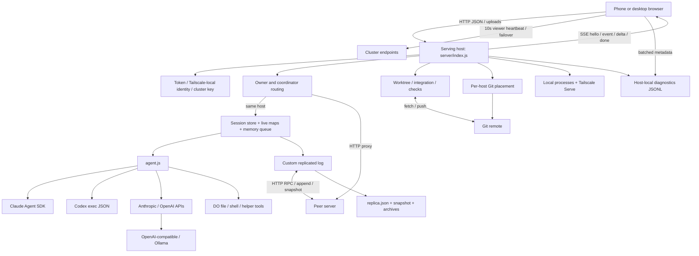
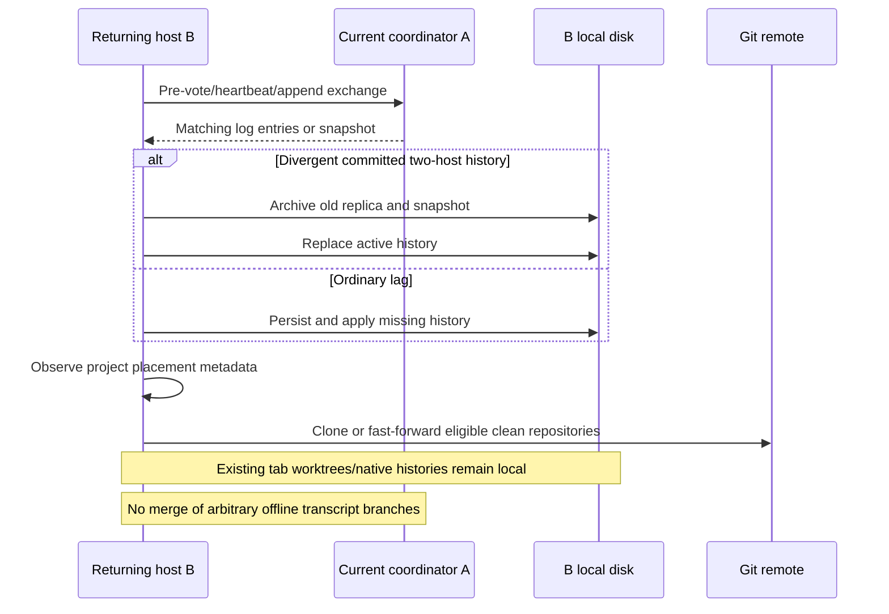

# The DO — Complete Technical Architecture and System Intelligence Dossier

**Investigation date:** 30 October 2026.

**Source baseline:** `4a65c8cf8d1614097182eb8b9bd7023dfb97faa0`.

**Purpose:** An evidence-based handoff to an architect who does not have repository or runtime access. This is an investigation, not a proposed implementation assignment.

## Reading this report

Evidence labels have specific meanings:

- **Verified:** Directly inspected implementation, Git metadata, a safe local verification, or operational API output during this investigation. A verified implementation is not necessarily a verified production behavior.
- **Documented:** A statement in repository documentation or a historical verification record, not independently demonstrated here.
- **Inferred:** A consequence or risk derived from the inspected implementation, with the assumptions stated.
- **Unknown:** The available evidence cannot establish the answer.

Paths and line numbers refer to the baseline above. Ranges identify the relevant implementation rather than implying every line supports every sentence. The report deliberately excludes credentials, private conversation contents, personal project inventories, machine addresses, and unnecessary device identifiers. The accessible macOS computer is **Host A**; its paired, inaccessible Windows computer is **Host B**.

The investigation read the main execution, persistence, replication, routing, frontend, provider, Git, startup, diagnostics, and test implementations; inventoried supporting modules; examined recent commits; and used supported runtime status/diagnostics endpoints. It did not inspect protected application-data files, other projects, or the other computer's filesystem. No provider inference, project execution, fault injection against the live application, restart, Push, or source edit was performed. The only created file is this report.

A note about “read-only”: the supported diagnostics GET endpoint itself runs its normal retention maintenance; aggregate diagnostics can also record a peer observation. Those are existing server behaviors, not investigative mutations. No settings, queue, membership, or project mutation API was called.

## 1. Executive technical assessment

**Verified:** The DO is a personal, host-operated development environment with a browser interface, a Node.js backend on each computer, several AI adapters, isolated Git worktrees, and a custom replicated metadata/transcript log. It runs real commands and development servers on the user's computers. A phone is a remote browser client, not an execution host or voting replica.

Its most useful abstraction is a **project containing multiple independently executing conversation tabs**, each tied to an execution computer and usually an isolated Git worktree. A user can switch among API models, subscription coding agents, and local models, retain a portable conversation record, review/publish changes through an explicit Push operation, and access the system over Tailscale.

The application is not just a web wrapper around one agent, but it also does not preserve every native agent capability. Claude uses the Agent SDK and has an interactive bridge and conditional native resume. Codex execution still uses noninteractive `exec` with transcript replay. API models use DO's own agent loop and tools.

The distributed system has **three different continuity mechanisms** that must not be confused:

1. The custom cluster log distributes saved session objects, project records, selected shared settings, attachment assets, and cluster metadata.
2. Git distributes **published repository history** to explicitly placed project copies.
3. Each execution computer retains its own live processes, private tab worktrees, native agent history, model installations, and diagnostic history.

**Verified:** Two voting computers intentionally allow one-computer commitment. A partition can therefore produce independently accepted histories. Reconnection chooses a log history and archives a losing history; it does not merge independent conversation or project-record changes. Three or more computers use majority requirements, including joint membership conditions. Calling the entire implementation ordinary strongly consistent Raft would obscure the explicitly different two-host semantics.

**Verified:** Several substantial safeguards exist: unique worktrees, explicit publication, remote-tip rejection rather than force-push, validation before publication, session owner/epoch checks, refusal to move an existing worktree between computers, no automatic replay of uncertain mutations, snapshot/archive recovery, and bounded metadata tracing.

**Verified / Inferred:** Important remaining concerns include volatile queues, acknowledged messages that are not durable executable jobs, partial-failure cleanup, whole-record concurrent updates, unbounded retained conflict archives/assets, provider capability inconsistencies, incomplete browser escaping, and a trust boundary substantially broader than the project-isolation UI suggests. The issue inventory below separates confirmed implementation defects from untested consequences.

The actual MVP is usable personal development infrastructure for a trusted operator on a small private network. It is not established as a secure multi-tenant service, a replicated workspace filesystem, an exactly-once job system, or a seamless offline conversation merger.

## 2. Current operational state and evidence ledger

### 2.1 Git and running processes

| Item | Finding | Evidence |
|---|---|---|
| Investigation branch | `harness/tab-fcd336ff44dd8d125b0f37b2` | **Verified:** `git branch --show-current` |
| Checkout HEAD | `4a65c8cf8d1614097182eb8b9bd7023dfb97faa0` | **Verified:** `git rev-parse HEAD` |
| Published `main` | Same full SHA | **Verified:** read-only `git ls-remote origin refs/heads/main` |
| Initial working-tree changes | None | **Verified:** initial `git status --short` returned no entries |
| Host A running revision | Same full SHA, `dirty:false` | **Verified:** `/api/harness/status` |
| Host A process start | `2026-10-30T04:17:49.705Z` | **Verified:** running version metadata |
| Runtime update state | No newer commit reported; update pass skipped because busy; no restart required | **Verified:** status snapshot, not a future guarantee |
| Host B | Windows member, inactive/unreachable | **Verified:** cluster status and aggregate diagnostics |
| Host B current build | Unknown | No reachable process response; do not infer from GitHub or Host A |
| Cluster | Two-host availability; Host A writable leader | **Verified:** runtime status |
| Cluster term / commit | Term 471; committed and replicated index 9034 at observation | **Verified:** point-in-time status |
| Conflict counter | 11 on Host A | **Verified:** counter, not 11 proven user-visible data-loss incidents |
| Host B last recorded contact | Milliseconds since epoch `1791712502941` | **Verified:** stored status metadata; not proof of last physical power-on |

The server was busy during investigation. The report did not interrupt that work. Runtime metadata is a snapshot, not an assertion that the same state persists when this report is read.

### 2.2 Recent history independently checked

`git log` and `git show --stat 673944a2` establish these changes:

| Commit | Committed UTC | What current code/history establishes |
|---|---|---|
| `673944a` | 2026-10-30 03:55:12 | Fifteen-file hardening change: Claude SDK integration, interactions, effort handling, message acceptance/reconciliation changes, remote-app status distinctions, service-worker simplification, tests and documentation. Diff: 595 insertions / 210 deletions. |
| `261d568` | 2026-10-30 04:08:49 | Three-file Markdown-table rendering change and regression coverage. |
| `4a65c8c` | 2026-10-30 04:16:46 | Three-file startup-election recovery change, tests, documentation. |

These are verified commits. Earlier conversational descriptions of all other fixes are historical context, not a substitute for the current implementation analysis below.

### 2.3 Operational traces

The aggregate endpoint returned up to 1,000 recent events from Host A and `unavailable:true` for Host B. The first sample covered approximately 04:10:26–04:22:51 UTC. It included 513 server request completions, 288 browser request events, 143 visible-state events, 16 actions, two turn starts, one recorded turn completion, Push lifecycle events, and server/cluster lifecycle events. This is a capped window, not complete usage statistics or an error-rate denominator.

**Verified:** For one browser page, startup emitted `waiting` at 04:17:52, 04:17:56, 04:17:59, and 04:18:02, followed by `ready` at 04:18:05. `/api/state` returned 503 during that interval. This supports that the new retry flow progressed to ready after temporary startup failures. The traces do not independently prove which exact pixels were visible or that every user control was usable.

There were also 403 responses in the coarse `api.nodes` route category. Source inspection shows that all `/api/nodes` routes reject when no application token is configured (`server/index.js:1003–1004`), unlike the newer cluster routes; this is a concrete possible explanation, not proof of the exact observed request. **Unknown:** their precise target/action and cause; route summaries omit subpaths and bodies. They must not be confidently attributed to the election or to a particular user mistake.

Host A diagnostics reported roughly 21.3 MB of retained trace data, 12.9 billion free bytes (about 12.0 GiB), configured 2,048 MB / 14-day retention, and zero current-process dropped/write-failure counters. Its effective trace cap was approximately 647 MB because the free-space percentage safeguard was lower than 2 GiB. The older claim of approximately 56 GiB free is not the current observation. Host B disk capacity remains unknown.

## 3. Product identity, workflows, and maturity

### 3.1 Intended versus actual product

**Documented:** README describes “projects, across your machines and models—with development history you keep,” self-hosted on a private network, with no configured machine-count limit. That is a product aspiration and configuration fact, not a scale benchmark.

**Verified:** A normal coding workflow is:

1. Start DO on a computer; configure an AI source and optionally phone access.
2. Create/register a project with a root directory, optional repository and start command.
3. Create a session/tab on an eligible host using that host's model catalog.
4. Send a message; the host records acceptance, prepares an isolated worktree, runs the provider, saves canonical events, and streams updates.
5. Continue or queue follow-ups; inspect changed files and pending Git status.
6. Press Push to save, integrate, validate and publish. Changes do not automatically enter the primary project checkout at ordinary turn completion.
7. Launch a registered application on its process-owning host and use loopback or Tailscale addresses.
8. For DO itself, Push its built-in project, then load the new server process and refresh browser assets.

A chat-mode session can discuss topics without a coding worktree. That intended no-tool behavior is implemented in the loop and several adapters, but the Anthropic API adapter currently disregards the `useTools` flag; see issue AG-02.

### 3.2 Feature inventory and maturity assessment

Maturity judgments are **Inferred**, based on implementation and coverage, not certification.

| Capability | Current implementation / maturity |
|---|---|
| Browser conversations, multiple sessions, model switching | Substantial implementation; canonical history, progress folding, attachments, session editing, usage display. Model changes replay or adapt history; they are not native-state migration. |
| Parallel project tabs | Substantial; separate worktrees, per-session execution, serialized integration per local repository. |
| Explicit Push / Merge latest | Substantial; real Git operations, checks, bounded AI repair, publication receipts. Several edge/failure cases remain. |
| Claude native execution | Partial native parity; SDK tools, questions, permission callback, effort, conditional resume, streaming. Live vendor behavior not validated here. |
| Codex native execution | Partial; `exec --json`, streamed item mapping and account-limit observation, no native interactive bridge or thread resume. |
| API/local-model execution | Working adapter architecture; DO tools and loop. Provider-specific consistency defects remain. |
| Project placement | Implemented Git clone/adoption and clean fast-forward; no uncommitted-file synchronization. |
| Distributed shared records | Implemented custom replication, ownership and recovery; two-host divergence is an explicit architectural limitation. |
| Pending messages | Multiple FIFO entries, edit/cancel, refresh reconstruction; not restart durable. |
| Phone/desktop UI | Shared responsive dark UI, viewport previews, network gate, host failover; handcrafted state coordination and renderer. |
| App lifecycle | Local process discovery/start/stop, Tailscale routes; remote owner control is incomplete. |
| Diagnostics | Bounded host-local metadata with Settings controls and aggregated reads; useful evidence, not full session replay or layout telemetry. |
| Recovery | Conflict/pre-join archives and missing-project recovery; not general semantic conflict resolution or backup of project files. |
| Local GPU helper | Explicitly enabled Ollama sources, bounded no-tools helper requests; not distributed autonomous agent scheduling. |
| Jev / TypeSafe | Optional structured evaluation API integration; account capability/configuration not tested. |
| Voice, monitors, notifications, usage | Implemented supporting features with separate runtime dependencies; not all exercised by default E2E tests. |
| Customer-facing product isolation/rate limiting | Not established. Current architecture assumes trusted host/network operation. |

### 3.3 Difference from using a native agent directly

**Verified:** DO adds cross-host browsing/routing, shared project/session records, portable event history, a uniform browser/phone composer, local model catalogs, Git worktree isolation and publication checks, app launching, and diagnostic context. It also adds a coordinator availability dependency and multiple conversions between native and canonical history.

The native coding tool still owns much of its execution semantics. DO can lose capabilities by using a narrower interface, suppressing tools, translating prompts, or failing to expose native controls. A uniform visual model picker does not imply equivalent sandboxing, context management, or approval behavior across adapters.

## 4. Technology, processes, and dependency architecture

### 4.1 Technology inventory

**Verified:** Production application logic is JavaScript ES modules on Node.js. The supported startup path requires Node 22 or newer. There is no React/Vue frontend, no bundler/build step for the web UI, and no relational database.

Locked principal dependencies:

| Dependency | Locked version | Role |
|---|---:|---|
| `@anthropic-ai/claude-agent-sdk` | 0.3.280 | Claude Code query execution and source discovery |
| `@anthropic-ai/sdk` | 0.124.0 | Anthropic Messages API |
| `openai` | 7.10.0 | Chat Completions, Responses, compatible endpoints |
| `cross-spawn` | 7.0.6 | Portable CLI subprocess launches |

Other implementation languages include CSS/HTML, Windows command scripts, POSIX shell, Python launcher/build helpers, and a Swift macOS launcher. Optional browser screenshot tooling uses Playwright; it is not a declared production dependency. External executables include Git, GitHub CLI where required, Tailscale, provider CLIs, Ollama, platform process tools, and OS notification facilities.

### 4.2 Directory responsibility map

| Area | Principal files and responsibility |
|---|---|
| HTTP/application orchestration | `server/index.js` (2,461 lines): authentication, request routing, sessions, providers, app/Git operations, cluster RPC endpoints, restarts, timers, diagnostics. |
| Browser application | `server/public/app.js` (3,834 lines): state, rendering, composer, SSE, settings/sheets, projects, models, Git, startup recovery. |
| Browser shell | `index.html`, `styles.css`: DOM structure, dark theme, responsive layout; `sw.js`: old-cache cleanup only. |
| Browser support | `cluster-client.js`: membership heartbeat/failover; `diagnostics.js`: metadata instrumentation; `voice.js`: dictation; `app-preview.*`: iframe viewport previews. |
| Agent core | `src/core/agent.js`, `tools.js`, `transcript.js`, `providers/*`: execution loop, tool boundary, canonical events and provider conversion. |
| Session/model storage | `store.js`, `config.js`, `secrets.js`, `attachments.js`, `usage-store.js`. |
| Distributed core | `cluster/raft.js`, `index.js`, `execution.js`, `pairing.js`, `devices.js`, `viewers.js`, `machines.js`. |
| Distributed project support | `placement.js`, `workspaces.js`, `assets.js`, `project-import.js`, `project-recovery.js`, `restart.js`. |
| Git/publication | `tab-workspaces.js`, `git.js`, `github-auth.js`, `app-ai.js`. |
| Host/app services | `apps.js`, `platform.js`, `tailscale.js`, `network-gate.js`, `nodes.js`, `ai-sources.js`, `source-discovery.js`, `machine-help.js`. |
| Observability/notifications | `diagnostics.js`, `monitors.js`, `beacon.js`, `usage.js`, `notify.js`, `email*.js`, `sms.js`, `transcription.js`. |
| Launch/update | `scripts/start.mjs`, `startup-update.mjs`, `launch.mjs`, `restart-server.mjs`, `stop-server.mjs`, launcher wrappers. |
| Tests/docs | `test/run.mjs`, `test/e2e/*`, `test/fixtures/*`, two additional top-level tests, README and `docs/*`. |

This is a modular core under a monolithic application coordinator and monolithic browser controller. Module boundaries exist, but many state transitions are orchestrated directly in `server/index.js`.

### 4.3 Architecture and dependency map



The dependency direction matters: Git publication does not commit a replica transaction; a replica session save does not copy the worktree; a successful native model call does not guarantee final session cleanup; and browser receipt of a stream event is distinct from user-visible completion.

### 4.4 Transports and background work

**Verified:** Browser/backend communication is HTTP JSON, raw-byte uploads, and Server-Sent Events. Cluster communication is authenticated HTTP POST RPC and HTTP streaming proxies. No application WebSocket transport was found in the principal execution path. Codex discovery uses its separate app-server protocol, while Codex turns use `exec`; do not conflate those integrations.

Important periodic work:

| Work | Interval / bound | Source |
|---|---|---|
| Replica heartbeat/election tick | 700 ms; single tick busy guard | `cluster/raft.js:454–467` |
| Running owner/epoch checks and orphan recovery | 500 ms | `server/index.js:2296–2331` |
| Cluster health trace/version observation | 10 s, change-triggered recording | `server/index.js:2231–2242` |
| Harness fetch/update/possible rollout | 30 s, guarded | `server/index.js:2264–2288` |
| Durable host-seen updates | 30 s | `server/index.js:2332–2341` |
| Project placement | 10 s check; approximately 120 s steady-state reconciliation | `server/index.js:2344–2351` |
| Legacy workspace-checkpoint deletion | 60 s | `server/index.js:2353–2361` |
| Usage aggregation | 60 s | `server/index.js:2364` |
| Stall watcher | 30 s | `server/index.js:2375–2407` |
| Browser state reconciliation | 20 s plus visibility/online events | `app.js:3714–3727` |
| Browser serving-host network probe | 3 s; 10 s abort deadline | `app.js:3770–3815` |
| Browser cluster viewer heartbeat | 10 s; 6 s deadline | `cluster-client.js` |
| Browser diagnostics flush | 3 s; 100-event buffer | `public/diagnostics.js:9–67` |
| Local-model runtime status | 2 s while applicable | `app.js:3817–3834` |
| SSE keepalive | 15 s | `server/index.js:2127–2150` |

The frequencies are small individually but interact with host probes, complete session serialization, shell process discovery, and multiple browser windows. No capacity benchmark was found that establishes a safe concurrency/machine-count ceiling.

## 5. Persistence, data ownership, and consistency

### 5.1 Physical stores

**Verified:** Default macOS data root is `~/Library/Application Support/harness`; Windows uses `%LOCALAPPDATA%/DistributedOrchestrator` (`platform.js:6–9`). `HARNESS_DATA_DIR` overrides it. These paths are described from source, not inspected for private contents. Non-Windows platforms currently inherit the macOS-style default path.

Core schemas:

- Standalone session: `<data>/sessions/<id>.json` containing identity, name/model/mode, project directory/app ID, timestamps, events, optional ownership/worktree/native fields.
- Replica disk: `<data>/cluster/replica.json`: cluster ID and shared secret, term/vote, commit/base/base term/base ID, initial membership, log entries `{term,id,command}`, and conflict count.
- Snapshot: `<data>/cluster/snapshot.json`: `{index,term,id,configuration,state}`.
- Replica state: `{sessions,viewers,preferred,history,values}`. `values` includes `settings:apps.json`, `settings:secrets.json`, `asset:<hash>`, `placement:<host>`, host sightings and other metadata.
- Project registry: `<data>/apps.json`, `{apps:[...]}`; built-in `__harness` is synthesized rather than stored as editable registry data.
- Per-host placement: `<data>/cluster/placements.json`, mapping project ID to local directory/adoption metadata.
- Worktree: `<git-common-dir>/harness-tabs/<24-character session hash>`, branch `harness/tab-<hash>`.
- Diagnostics: `<data>/diagnostics/settings.json` and rotating JSONL files.
- Other local stores: models, secrets, attachments, usage ledger, monitor definitions, notifications, explicit execution nodes, app history, and server/runtime logs.

### 5.2 Ownership matrix

| State | Physical authority and durability | Replication / discovery | Offline, reconnect, concurrent-change behavior |
|---|---|---|---|
| Project registry | Local JSON mirror; coordinator's replicated settings value in shared mode | Whole registry string checkpointed | Visible across hosts; losing partition history can replace it. Local concurrent read-modify-write is not serialized. |
| Primary repository | Host filesystem / Git repository | Only selected hosts clone/fetch from Git remote | Offline copy remains; clean copies fast-forward later; dirty copies retained. Metadata visibility does not imply a clone exists. |
| Session worktree and unsaved files | Owning host's Git common directory | Not copied by cluster | Owner must return. A new host cannot recover unpublished files from a transcript. |
| Session definition | Standalone session JSON or full replicated session object | Full saved object | Owner assignment plus epoch checks; ordinary updates replace whole object, not field-level operations. |
| Conversation events | Embedded session events | Replicated with full session save | Saved history can be read when owner offline if coordinator available. Competing branches are archived, not merged. |
| Accepted immediate message | Canonical user event saved before acknowledgement | Same session mechanism | Survives saved-history recovery; does not constitute a durable job with guaranteed future execution. |
| Queued message | `messageQueue` Map/arrays in owner process | SSE/HTTP observation only | Refresh survives; process crash/restart loses it. No cross-host migration. |
| Live running turn | `running`, `live`, provider subprocess plus replicated turn marker | Marker only, not executable continuation | Epoch recovery marks interruption; no replay. External side effects may already have happened. |
| Pending native interaction | Owner-process Maps and promise chain | SSE hello/current request query | Browser reconnect works; process restart loses request and interrupts turn. |
| Claude native history | Native SDK/CLI local storage; DO stores reference/fingerprint | Native history not replicated | Resume requires same owner/cwd/model alias/history; otherwise canonical replay. |
| Codex native history | CLI local storage and rollout observations | No native resume bridge | Next turn starts another exec invocation with replayed text. |
| Attachments | Local files plus content-addressed cluster assets | Base64 bodies in replicated `asset:` values | Restore verifies checksum and writes local file; distinct from arbitrary project files. No observed GC protocol. |
| Model definitions/defaults | Host-local `models.json` | Catalog queried from execution host | Local endpoints, binary paths and models are not silently substituted from serving host. |
| Stored API secrets | Local `secrets.json`, shared setting checkpoint | Shared between trusted cluster hosts | Credentials travel with cluster state; local CLI authentication does not. Alias meaning remains host-specific. |
| CLI logins/model weights | Local provider/Ollama installation | Not replicated | Must install/login/download independently. |
| Cluster identity/membership | Durable replica/identity files | Membership commands and snapshot | Fixed voter membership until changed; offline member not automatically removed. |
| Browser selection | URL `session`/`node`, sessionStorage | Per-window selection; failover carries session | No shared localStorage session selection; unsent draft carried only on explicit failover redirect. |
| Device/viewer observations | Tailscale observations and replica viewer metadata | Shared viewer/status records | Heartbeat expiration is not proof of a person leaving; peer sightings can be stale. |
| Usage totals/notifications/monitors | Host-local stores | Not generally replicated | Unavailable host means unavailable local evidence/configuration. |
| Diagnostic events | Serving/executing host JSONL | Aggregate reads only | Host-local retention; inaccessible peers contribute no events. |

### 5.3 Standalone versus shared persistence

`store.js:73–112` serializes standalone writes per session, uses unique temporary filenames, then renames. It does **not** explicitly fsync the standalone file or parent directory. Atomic replacement prevents a half-written JSON pathname under normal process failure, but is not a proof of power-loss durability.

Shared saves call `cluster.saveSession`, routed to the writable coordinator and serialized by session ID (`cluster/index.js:85–108`). Replica persistence uses `atomic()`, file fsync, rename and directory fsync on non-Windows (`raft.js:31–42`). Windows skips directory fsync. A whole updated session is one command; there is no transactional database or per-event append-only session table.

`store.load` can repair dangling tool calls and save the repaired transcript. A GET of a session is therefore not universally observational. Separate from session saves, app and monitor registry writers use shared temporary names and read-modify-write sequences without the session store’s per-record write queue. Active sessions use the live object to avoid repairing a legitimately pending tool. Standalone `list()` silently skips corrupt files; `apps.load()` treats any read/parse failure as an empty registry. Those choices keep the interface responsive but can hide storage damage and allow subsequent writes to replace damaged data.

### 5.4 Joining and new-machine discovery

**Verified:** `cluster/index.js:201–242` stops the joining replica, obtains an admission snapshot, preserves a `before-join-*` export, imports cluster state, activates membership, then proposes one `project-import` operation for the joining machine's apps/sessions/assets. Protocol version 1 is checked before the import proceeds. The UI pairing flow verifies an online Tailscale DNS peer and HTTPS callback, uses a pending nonce and host-bound invitation, and expires requests after ten minutes (`pairing.js:10–119`). Legacy token/code pairing also exists.

`project-import.js:3–27` preserves existing records, remaps conflicting app/session IDs using the joining host ID, adjusts session app references, defaults ownership, and clears imported live-turn markers. Its idempotence is conditional on existing records still being present; it is not a permanent operation/tombstone ledger.

A joined machine receives existing project records and conversation state through the replica. It does not automatically receive every project's directory. `hosts` placement determines clones; a missing Git remote leaves an additional copy waiting. The built-in DO project uses each machine's own installed checkout.

**Inferred:** Admission, activation, import, and local-state adoption are separate durable operations. A crash after membership activation but before project import can leave an already-joined computer whose former local projects require explicit recovery. The pre-join export helps preserve evidence, but there is no inspected resumable join transaction that guarantees completion of every phase after restart.

### 5.5 Log reconciliation and partitions

The relevant rules are explicit in `raft.js`:

- Pre-vote avoids disrupting a reachable healthy leader; elections wait roughly 3.5–6.5 seconds plus transport latency (`resetElection`, `preVote`, `campaign`).
- One/two members need one qualifying member. For three or more, both relevant majorities are required during membership transition (`enough`, lines 129–140).
- `writable()` also requires the committed log term to match the current term. A newly elected leader appends a no-op before becoming fully writable.
- Per-peer replication has one in-flight request, batches up to 32 entries with an approximately 8 MB target, and sends snapshots when the peer is behind the compacted base.
- Compaction threshold is 64 committed entries or 16,000,000 bytes. Snapshot state is reconstructed exactly to its index, preserving later entries separately (`compact`, lines 153–175).
- Divergent committed append histories in two-host mode trigger archive then replacement. Majority-mode append conflicts refuse replacing committed history (`receive`, lines 248–270).
- Snapshot installation archives existing history and replaces snapshot/log state (`install`, lines 293–310). Its guard structure differs from append conflict handling; it does not independently apply the same majority-mode committed-conflict refusal.
- Proposal timeouts and coordinator changes explicitly say the result is uncertain; they do not automatically resubmit arbitrary operations.

#### Example A: independent session work on two disconnected computers

Both computers have a common prefix. A accepts updates to session A; B accepts updates to session B. Each may acknowledge saves under one-member quorum. When they reconnect, one history becomes authoritative according to election/log protocol conditions. The other branch is archived and replaced. The active state is **not guaranteed to contain both sessions' latest updates**, even though the changes concerned different records. Git files on each computer are a separate concern and may remain intact.

#### Example B: delete on A, edit on B

A removes a session; B still has its prior version and edits it. If B's branch wins, the deletion can disappear. If A's branch wins, B's edit leaves active state and survives only in an archive. There are no persistent per-record deletion tombstones in `applyCommand`; a session delete removes the map entry. The same absence matters to late saves because `sessionWriteError` accepts a write when no current record exists.

#### Example C: concurrent code publication

Both computers edit isolated branches against a shared Git remote. The first successful non-force push advances the remote. The second integration detects a changed tip, fetches/merges/rechecks, and retries at most three times. This is Git's concurrency mechanism, **not** cluster transcript reconciliation. A code merge can succeed while conversation history still has a partition conflict.

#### Example D: owner lost while another host remains online

The coordinator observes a stale/offline turn owner and records an interruption with an incremented execution epoch. The surviving process cannot safely replay its tools elsewhere. If the old owner later attempts a save with the old epoch, it is refused. However, JavaScript epoch checks cannot revoke an external command, child daemon, Git side effect, or network request already issued.

### 5.6 Recovery scope

`project-recovery.js:24–99` scans pre-join/conflict exports and local session/registry files, replays committed archived commands, keeps newer candidate records by timestamps, and lists projects absent from current registry. Restore performs a project import, not a filesystem restore.

It excludes built-in Harness projects and filters out any candidate whose app ID already exists. Thus it is not a general recovery browser for missing messages in an existing project or for all conflicting versions of the same session. Archived conflicting transcripts may exist without being selectable through this recovery UI. Recovery also cannot prove original repository directories still exist without inspecting those hosts.

## 6. Agent integration and native capability parity

### 6.1 Canonical execution contract

`providers/index.js:14–49` registers five adapters: `anthropic`, `claude-cli`, `codex-cli`, `openai`, `openai-responses`. Ollama sources are represented as OpenAI-compatible models with `sourceKind:'ollama'`.

`agent.js:214–388` owns the shared loop. It appends canonical user/assistant/tool-result/note events, builds a per-turn provider spec, injects the DO system context, streams deltas, persists native steps in order, runs DO tools for API adapters, and stops on a final model response, cancellation or error. It no longer contains a 40-step cutoff or the extra model-generated closing-summary call. The loop is `for (;;)`. Removing that limit does not remove provider output limits, context conversion budgets, configured Claude `maxTurns`, cancellation, or tool timeouts.

The canonical transcript stores user text/attachments, assistant text/thinking/tool calls/usage/provider/model, tool results, notes, and file/publication events (`transcript.js:22–115`). It is a portable approximation, not a complete native protocol event archive. Tool output is capped at 200,000 characters for canonical results; DO tool execution returns at most 30,000 characters. `renderForPrompt` reduces older tool output before less recoverable conversation material; API budget trimming is character-based, not a tokenizer-verified limit.

### 6.2 Adapter parity table

This compares **capabilities actually exposed by these adapters**, not an exhaustive assertion about the latest external products.

| Capability | Claude Agent SDK | Codex exec | OpenAI Chat / Responses | Anthropic API | Ollama/compatible |
|---|---|---|---|---|---|
| Transport | SDK `query`, native subprocess protocol | `codex exec --json`, stdin text, stdout JSON lines | SDK streaming HTTP | SDK streaming Messages | HTTP compatible adapter / Ollama management APIs |
| Native tools | Yes, SDK owns tools | Yes, CLI owns tools | No; DO tools | No; DO tools | DO tools only if configured/capable |
| Native session identity | Captured init session ID | Thread ID used for observations, not resume | No native coding session | No native coding session | No native coding session |
| Resume across DO turns | Conditional same-host/cwd/alias/fingerprint | No | Canonical event replay | Canonical event replay | Canonical event replay |
| Questions | `AskUserQuestion` callback rendered | No interactive bridge | Ordinary text response, not equivalent native structured bridge | Same | Same |
| Permissions | SDK `canUseTool`, allow once/decline; configurable modes | Noninteractive; sandbox bypass by default unless `sandbox:true` | DO tool policy | DO tool policy | DO tool policy |
| Reasoning | `spec.effort` passed | CLI configuration passed | `reasoning_effort` / `reasoning.effort` | `output_config.effort` | Endpoint-dependent |
| Compaction | Native SDK may manage its native history; fresh replay also bounded | Native behavior inside exec; each later turn replays DO history | DO character-budget conversion | No comparable explicit history budget in adapter | Endpoint/DO budget-dependent |
| Stop | AbortController to SDK | SIGTERM to direct child | Request abort plus DO loop cancellation | Request abort plus DO loop cancellation | HTTP abort/local jobs separate |
| Native terminal UX parity | Partial | Substantially incomplete | Not applicable | Not applicable | Not applicable |
| Verification present | Real installed SDK with deterministic protocol fixture | Adapter code and usage logic; no equivalent native interaction E2E | Synthetic streaming API fixture | Source inspected; not live validated | Synthetic local-runtime workflows |

### 6.3 Claude details

**Verified:** `claude-cli.js:157–192` calls `query({prompt,options})` with cwd, environment, AbortController, partial messages, optional model/effort/maxTurns/resume, preset `claude_code` system prompt plus appended DO instructions, and setting sources `user`, `project`, `local`.

Default permission mode is `default`. `acceptEdits`, `plan`, and `bypassPermissions` can be selected; bypass sets the SDK dangerous-skip option. The browser exposes a generic effort list, not a provider-version-specific supported-level schema. Unsupported values can reach the provider and fail.

A custom `spec.bin` overrides the executable. When the client bin is exactly `claude`, no path override is supplied, so execution selection is delegated to the SDK. Installation discovery and executable availability do not by themselves prove the exact running SDK executable/account can perform a real turn.

Native session eligibility in `agent.js:272–281` binds owner, cwd, configured model alias and a SHA-256 fingerprint of canonical user/assistant/tool-result fields. It compares prior fingerprint against history excluding the newly accepted user event. On resume, the prompt contains only the latest user event; on a fresh native session it contains converted canonical history. Changing provider or editing included history generally invalidates resume. The fingerprint does not include every session option, attachment detail, system instruction or underlying model-definition change, so the equivalence relation is narrower than “all relevant context unchanged.”

SDK assistant/tool-result steps are queued through `stepSaves` and drained before completion (`agent.js:284–329`). Partial text/thinking is streamed and flags suppress re-emission when complete assistant blocks arrive. Rate-limit events update separate subscription-limit information. Native usage totals are assigned to the final assistant event rather than summing fragmentary stream totals indiscriminately.

Questions/permissions are serialized per session through `interactionChains` (`server/index.js:155–183`). A request has a UUID, kind, tool and input. `GET/POST /api/sessions/:id/interaction` and SSE hello expose current state. Responses must match the current UUID, include a boolean approval, and answer every question for approved question requests. Stale responses get 409. Stop resolves pending interactions as denial. Questions appear as textareas with option descriptions; native multi-choice interaction semantics are not fully reproduced (`app.js:1027–1062`).

**Verified limitation:** AI integration repair calls `runTurn` without `requestInteraction` (`server/index.js:1610–1632`). The Claude adapter explicitly denies any permission callback without that surface. Ordinary chat Claude capability does not automatically mean the Push repair path can obtain needed permissions or ask a question.

### 6.4 Codex details

`codex-cli.js:177–212` launches:

```text
codex exec --json --skip-git-repo-check [--model ...]
  [-c model_reasoning_effort="..."]
  [--dangerously-bypass-approvals-and-sandbox] -
```

The dangerous bypass flag is present unless the model definition explicitly sets `sandbox:true`. This adapter is not run through DO's `tools.js` macOS shell wrapper. The comment claiming the harness already decides everything the session may touch is not a cross-platform security guarantee.

The complete converted conversation is sent over stdin. A 1,048,576-character input ceiling minus headroom is imposed, also intersected with an approximate context-token-derived budget. There is no `exec resume` or interactive app-server execution bridge here. The repository does use Codex app-server for **source discovery** (`source-discovery.js:23–65`), which must not be mistaken for a native turn integration.

Events map text, commands, tool results and usage into DO's representation. Local rollout inspection is used to obtain rate-limit information not emitted in exec JSON. That coupling depends on native file/protocol formats. Cancellation sends SIGTERM to the direct child; process-tree completion and already-created background jobs are not proven cancelled.

### 6.5 API and local-model details

OpenAI Chat and Responses pass optional effort, token caps and `extraBody`; `extraBody` is spread last and can override standard fields. If context/soft limits are configured, character heuristics budget converted messages. `softLimitTokens` is used unless the session enables long context. No provider-native coding session is resumed.

**Verified defect:** Responses maps `response.incomplete` to stop reason `incomplete`, but only `response.failed` sets `reply.error` (`openai-responses.js:98–115`). The common loop only treats `length` and `max_tokens` as truncated failures (`agent.js:350–356`). Thus an incomplete Responses result without tools can be classified as an ordinary response.

**Verified defect:** Anthropic API `complete()` does not accept/use `useTools` and always sends `toAnthropicTools()` (`anthropic.js:21–30`). A chat-mode session or helper requesting no tools is not guaranteed no tool exposure through this adapter. Adaptive thinking and summarized thinking display are always requested; a beta rejection has a fallback endpoint path, but this is not a general compatibility negotiation for every Anthropic-compatible model.

Ollama management (`ai-sources.js`) discovers installed local completion models, excludes remote/cloud models for local helper use, checks tool capability, supports pull/load/unload and runtime startup, and tracks bounded in-memory job results. Explicit helper calls require `allowDelegate`, prompt length at most 24,000 characters, no tools, 2,048 predicted tokens, 8,192 context tokens and a 180-second request timeout. Jobs and helper admission share a local busy set; ordinary chat execution is not a general global GPU-concurrency scheduler. Local model weights and logins remain host-local.

The `budgetOpenAI` helper is also reused for Responses items even though Responses tool outputs have a different shape; it cannot perform its normal tool-output trimming on those items. This is a distinct adapter mismatch, not merely an uncertain token heuristic.

### 6.6 Limits and outcomes that must not be conflated

- A provider returning successfully means it returned a response, not that the user's engineering objective was achieved.
- `turn.finished` currently emits `completed` when no error/cancel flag is set; this includes legitimate clarification/final responses, not just completed projects.
- Native compacted history and DO's canonical replay are different representations. Portability can lose native reasoning/tool metadata.
- The DO loop no longer has a step cap, but individual tool operations remain timed and output-bounded.
- `boundedTool` stops waiting; it does not cancel the underlying operation (`agent.js:28–49`). The shell has its own timeout, but those mechanisms are not an exactly-once side-effect protocol.
- Permission requests are live-process interactions, not durable jobs. A restart cannot safely infer approval.

## 7. Frontend architecture and user journeys

### 7.1 State model

The browser is a single plain JavaScript application. `state` contains catalogs, session metadata, selected session, host state and display caches; `tabs.chat` contains the open session, EventSource, running state and live progress. There is no centralized immutable store, transaction system, or comprehensive request-generation framework.

Routing helpers prepend `/api/nodes/:id` for explicitly selected legacy execution nodes and attach `x-harness-session` for scoped requests. Separately, the backend cluster routes sessions to their owner. These are two distinct addressing layers.

The page's URL and sessionStorage preserve per-window selection (`app.js:619–675`), avoiding the earlier shared-localStorage selection coupling. Some other sessionStorage/localStorage accesses remain unguarded. Browser-storage denial can still break those isolated flows, particularly the cluster client initialization.

### 7.2 Loading and restoration

The network gate probes the page's serving host, not an offline selected execution node, and bounds headers/body with an AbortController. It disables the rest of the UI when connectivity is absent. Tailscale connectivity is a prerequisite for most API work even when using localhost (`server/index.js:849–853`, `network-gate.js`). This is a product choice that limits standalone use without Tailscale.

`initializeApp` is single-flight with a three-second retry after temporary errors. It refreshes state and reopens the saved session only if the user has not already selected another session. It no longer forces Machines settings open on election failure (`app.js:3729–3767`). Runtime traces in this investigation show waiting-to-ready progression.

However, most generic API requests have no explicit browser timeout, and `refreshState` awaits model catalog discovery before finishing session-list/busy-state updates (`app.js:1244–1289`). The network probe can succeed while a state/catalog request remains pending. Startup retry scheduling only occurs after the awaited operation rejects; it is not a watchdog for every stalled request.

### 7.3 Message send and acceptance

```mermaid
sequenceDiagram
    participant U as User/browser
    participant H as Serving host
    participant O as Session owner
    participant C as Coordinator
    participant P as Provider
    U->>U: Generate clientMessageId; provisional bubble; clear composer
    U->>H: POST session/send
    H->>C: Resolve authoritative owner
    H->>O: Proxy once, no failover replay
    O->>O: Deduplicate accepted event/pending entry/in-flight admission
    O->>C: Save turn marker, then accepted user event
    C-->>O: Commit acknowledgement
    O-->>U: HTTP acknowledgement + SSE saved event
    O->>O: Prepare worktree / runtime
    O->>P: Execute
    P-->>O: Deltas and steps
    O->>C: Persist canonical steps
    O-->>U: SSE event/delta
    O->>C: Save final state / clear marker
    O-->>U: done
```

A saved user event precedes HTTP acknowledgement (`server/index.js:595–605`). `clientMessageId` deduplicates retries against saved events, current pending entries and a transient admission Map (`server/index.js:2175–2203`). The HTTP acknowledgement is not a guarantee the provider has begun: worktree preparation/model loading follows it.

The browser reconciles matching saved events with provisional events; it avoids blindly deleting all pending messages. SSE pending version counters prevent some stale send-response overwrites. If HTTP fails after a matching SSE acknowledgement, the browser says the message was saved. If both acknowledgement paths are lost, draft restoration can still be ambiguous: a new manual Send generates a new client ID and may duplicate an already-accepted message. This is a risk requiring response-loss testing, not evidence that duplication happened in this trace sample.

### 7.4 Queues and pending UI

The queue is an owner-process FIFO, not a browser-only list. Multiple messages can be queued, edited by pending ID, or individually cancelled. The compact disclosure above the composer expands on click; render-key checks avoid overwriting an unchanged editing panel (`app.js:1064–1111`). Queue state is included in SSE hello so a refresh can restore it.

When an entry starts, it leaves the queue and a `starting` event can create a provisional conversation entry. Cancellation of a pending entry does not abort the active turn; Stop clears pending work and aborts the current turn. Stale edit/cancel receives conflict.

**Inferred race:** edit/cancel responses update `pendingMessages` without the send path's generation/version check. If an SSE queue transition occurs while that HTTP response is in flight, the later response can temporarily replace newer state with an older queue snapshot. Tests cover ordinary editing/cancellation and some send response ordering, not every permutation of this path.

### 7.5 Streaming, reconnect, and multiple windows

SSE emits `hello`, `started`, `pending`, `interaction`, `event`, `delta`, `done`, and `error`. Hello reconstructs current running/queue/interaction state. EventSource reconnects automatically; there is no durable SSE event-offset replay protocol. Recovery refetches the canonical transcript when a gap is suspected. Browser event-ID deduplication and provisional-message preservation are important compensating mechanisms.

Live text/thinking/tools are rendered separately from saved transcript events. Saved assistant steps can trigger transcript redraw and live-state reconciliation. Long transcripts are rendered in the DOM rather than virtualized. Whole transcript JSON and repeated redraws can become expensive independently of model time.

Each browser window has its own selected session. The single-page composer still holds drafts and selected attachments in memory; general refresh-durable drafts were not established. The cluster failover client carries unsent text in a URL fragment when redirecting to a previously authenticated reachable host. It does not replay sends/uploads and does not reconstruct all in-memory attachment/editor state.

### 7.6 Phone, formatting, previews, caches

The same DOM/CSS serves phones and desktops. The theme uses shared dark CSS variables. The pending panel, native interaction panel, attachment tray, composer, fixed sheets and visual viewport adjustments all participate in layout; testing only one panel in isolation is insufficient.

The Markdown renderer is handcrafted (`app.js:57–158`): fenced code, headings, flat lists, emphasis, links and tables. It is not full CommonMark/GFM. Tables now have headers/alignment and a scroll container. Nested Markdown, complex code spans/links, and streaming partial syntax remain custom-parser edge cases. The renderer's quote-escaping defect is discussed in the security inventory.

The service worker now only skips waiting, clears old `orchestrator-shell-*` caches and claims clients; it does not intercept fetch (`sw.js`). Static/API responses generally use `no-store`. Existing loaded pages still contain their old JavaScript until refreshed after a server update.

App previews are real iframes at 390×844 or 1280×900, scaled to fit; they are not phone OS/browser emulators. They use real app data and can cause real side effects. A frame load is recorded separately from proof the embedded app succeeded. Apps that deny framing need direct navigation.

## 8. Projects, permissions, and Git publication

### 8.1 Project abstraction

A project record contains ID, name, directory, repository, start command, allocated app/Serve ports, timestamps, PID and optional ownership/placement/AI-dependency data (`apps.js:257–340`). A nonempty start command or history marks it as an application; a chat project need not run a server. The special `__harness` project is synthesized and allowed to edit DO's source.

Session IDs combine time, a slug and UUID fragment (`store.js:31–69`). Sessions can fork history. `store.fork` constructs a new session from selected fields and copies events, but does not copy all source metadata such as app association/mode/permission/effort; preserving “same project, new model” semantics requires attention rather than assuming a complete clone.

App process discovery combines registered PID/ports and host process/listener inspection. Local metadata alone cannot establish that a remote app is running. `listWithStatus` now returns `runtimeKnown:false` for nonlocal owners (`apps.js:627–676`). Start/stop on a project whose process owner is not the coordinator is rejected with a “make that machine main” instruction (`server/index.js:1287–1292`). This is weaker than transparent session-owner routing.

### 8.2 Permission boundaries

**Verified:** There are several different policies, not one universal sandbox:

- DO file tools perform lexical `path.resolve` containment checks and optional read-only directory grants (`tools.js:64–103`). They do not resolve symlinks before enforcing containment.
- Harness source/data write protection is layered on those tools. Reads have a different rule: the absolute protected check is write-only, then `allowOutside` can return the path. The stronger “never read data” claim is not universally implemented by this function.
- On macOS, the DO shell wrapper uses `sandbox-exec` when present to deny reads of Harness data and writes of protected roots. The profile otherwise allows default operations; it is not a general project-only shell sandbox (`harness-guard.js:105–133`).
- If `sandbox-exec` is absent, the command runs without that wrapper (`tools.js:116–119`). Native Windows therefore does not inherit the macOS kernel guard.
- Claude SDK permissions are its own policy and settings, with callbacks surfaced through DO. They do not reuse DO file-tool containment checks.
- Codex defaults to explicitly bypassing approvals/sandbox and also does not reuse the DO file-tool guard.
- HTTP file previews use a separate route that accepts an absolute path and reads it without the file-tool confinement check (`server/index.js:1851–1895`).

This application should be evaluated as a trusted host automation tool. Project directory isolation is valuable workflow isolation; it is not currently a reliable security boundary against malicious tool output, agents, or network callers.

### 8.3 Worktrees and publication

`prepareTab` resolves the repository and common Git directory, initializes a repository when appropriate, refuses dirty shared roots, optionally fetches distributed project state, and creates a deterministic worktree/branch (`tab-workspaces.js:63–108`). An existing recovered worktree is reused without switching it to the current main. Clean new/reopened worktrees may merge the current root head; failed merges are aborted and pending work retained.

The project target is the primary checkout's current branch captured in `tabWorkspace.target`, not hardcoded universally to `main` or `master`.

```mermaid
sequenceDiagram
    participant U as Browser Push
    participant S as Owner server
    participant W as Isolated worktree
    participant R as Git remote
    participant T as Primary checkout
    U->>S: POST /api/git/push
    S->>S: Refuse busy/queued tab; mark integration running
    S->>W: Acquire repository lock; save tab commit
    W->>R: Fetch target branch
    W->>W: Merge local and remote target
    opt Conflict or failed checks
        S->>W: Bounded AI repair on same branch
    end
    W->>W: Install dependencies/checks; verify clean unchanged head
    W->>R: Non-force push candidate to target
    alt Remote advanced
        R-->>W: Reject
        W->>R: Fetch; merge; recheck; bounded retry
    else Published
        W->>T: Fast-forward primary checkout
        S-->>U: Saved receipt and result
    end
```

The lock is an in-memory per-repository queue plus a directory under the common Git directory. It excludes other local DO processes; it is not a distributed lock. A stale lock is deliberately not stolen automatically and requires recovery (`tab-workspaces.js:24–38`). Git remote branch updates provide the cross-host serialization point.

Validation runs `git diff --check`, then a custom `.harness-integration.json` command or package test script. Without checks, publication is refused. For npm projects it runs `npm ci` then `npm test`; commands have a ten-minute timeout with process-group termination where supported. The candidate must remain clean and at the checked head.

Conflict repair must retain prior and target ancestry, leave the current branch clean, and pass checks. Failed-check repair additionally rejects changes to test/check definitions. The latter protection is not identical to conflict-repair validation. The repair callback is limited to two attempts and five minutes per run, and does not expose the native interaction callback.

`Merge latest` integrates into the isolated tab and validates without publishing. Push with an existing remote uses the distributed-style remote-tip loop even if not a multi-host project. A lost push reply is checked by reading whether the remote now equals the candidate. There is no force-push fallback.

**Important partial-success boundary:** If the remote push succeeds and the local primary-checkout fast-forward or final transcript save fails, publication has happened even if the UI reports an error. The next attempt must inspect Git truth rather than assume the remote was unchanged.

New-repository publication uses a different path: validated primary checkout is advanced locally, then the remote may be created/pushed. Failure leaves a local validated commit. These distinctions matter for rollback expectations.

## 9. Security, authentication, tracing, and performance

### 9.1 Authentication/trust

`authorized()` trusts a matching cluster key, a supported token/cookie/ticket, or Tailscale identity headers received from a loopback proxy. If `TOKEN` is empty, it permits access (`server/index.js:317–337`). The shared launcher explicitly deletes `HARNESS_TOKEN` (`scripts/start.mjs:33`), and the server binds `0.0.0.0` (`server/index.js:2452`). Consequently, the normal launcher does not enforce an application bearer token on LAN-accessible routes.

Tailscale provides useful private-network transport, but it is not a per-project authorization model. Loopback Tailscale-header trust assumes the request came from the intended local proxy. Cluster peers share a secret and are trusted with shared API credentials and conversation state. The legacy explicit-node mechanism stores separate node tokens locally and forwards only selected headers (`nodes.js`). There are no user/organization/role/tenant tables in the inspected architecture.

Token cookies use SameSite=Lax but the shown setter lacks HttpOnly/Secure attributes. Whether a reverse proxy changes exposure is external to this source inspection. No complete Origin/CSRF, rate-limit, or browser content-security-policy layer was established. This matters because endpoints can launch commands, manage repositories/processes, and read local files.

### 9.2 Diagnostics

Server diagnostics whitelist token-like metadata strings and bounded numeric values; messages, request bodies, typed content and screenshots are excluded. Events include timestamps, server revision/host, correlation IDs, provider/effort, coarse routes, outcomes and timings (`diagnostics.js:32–49`). Browser actions generate correlation IDs; fetch wrappers carry them to server requests. Some proxy layers, notably `nodes.js`, do not forward all tracing/session headers, so correlation is not uniform across every route topology.

Retention defaults to 2,048 MB and 14 days. Segments rotate at roughly 4 MiB or one day; the effective cap also respects 5% of free space plus existing trace size, and recording stops below 2 GiB free. Settings expose size, download of recent events, retention, enable/disable and clearing. These limits apply to **diagnostics**, not all server logs, archives, native histories or attachments.

Every recorded event runs retention/disk checks and multiple directory/stat operations, serialized through one promise chain. This is simple and bounded but can be expensive at high volume. Browser buffers discard old events above 100; server admission drops above 1,000 queued events. Counters are not a durable guarantee of no past loss. A browser page disappearing before a successful flush loses evidence.

The route key generally stops after two path segments, e.g. `api.sessions`, losing the operation/session distinction. This protects privacy but impedes root-cause analysis. Generic `showBanner` traces call every nonempty banner `error`, including informational reconnect messages. Repeated clicks or error-labeled banners are not proof of frustration, layout overlap, or unsuccessful user intent.

### 9.3 Performance and capacity

There is no SQL database, event streaming infrastructure, or shared cache service. Whole JSON objects are repeatedly serialized and persisted. Large sessions can appear repeatedly in the uncompacted replica log, while each snapshot contains all current sessions and assets. Attachment base64 expands binary size. Every event save can therefore have costs far larger than the incremental event itself.

Other potential bottlenecks include complete session-list scans, synchronous JSON stringify/parse of large objects, repeated provider/environment discovery, OS process/listener shell-outs, non-virtualized transcript DOMs, and multiple concurrent browser pollers. Gzip is asynchronous for larger ordinary responses (`server/index.js:271–290`), and routine successful cluster RPC heartbeats are excluded from diagnostics, both useful optimizations.

Relevant caches are intentionally modest: model SDK clients in a Map; login PATH cached in-process; Tailscale hostname cached when obtained; network status TTL about two seconds; model discovery results ten minutes for validated add; display-only peer version cache with background refresh; placement local mapping; UI cached project display. `resetClients()` is used when settings/config change, but client cache identity only distinguishes key presence rather than key value. Correctness depends on all credential-changing paths invalidating it.

## 10. Tests and verification quality

### 10.1 What the default suite really runs

**Verified:** `npm test` runs `node test/run.mjs`, which enumerates only `test/e2e/*.test.mjs`, sequentially, each with a 180-second process timeout and injected deterministic Tailscale fixture. At this baseline there are three workflows:

| Workflow | Meaningful coverage found by inspection | Important limits |
|---|---|---|
| `distributed.test.mjs` | Two real Node server processes; owner routing/model locality; HTTP/SSE proxy; queue/edit/cancel/FIFO; parallel tabs; assignment fencing; abandoned turn recovery; project import/archive recovery; diagnostics redaction/rotation/remote visibility; Git publication/merge/check failures; deduplication; 41 API tool steps; effort rejection; Claude SDK protocol questions/resume/deny/stop; startup retry; renderer checks. | Both processes run on one physical test machine, synthetic endpoints and files, many frontend checks use VM stubs, not real layout. No exhaustive partition/concurrent-state proof. |
| `network.test.mjs` | Fake Tailscale state transitions against real server; disconnected API gate/recovery; preview behavior; browser probe timeout VM; local-model runtime fixture. | Does not reproduce real tailnet routing, Windows, Safari suspension, certificate or laptop sleep behavior. |
| `restart.test.mjs` | Actual child server replacement, identities/PIDs, serving after old process exits, multi-server restart orchestration. | Controlled processes, not power loss or kill during every persistence phase. |

Two additional files, `test/chat-model-label.test.mjs` and `test/harness-rollout-http.test.mjs`, sit outside the default runner's discovery directory. They contain label and rollout HTTP assertions, but are not included by `npm test` merely by existing. No reference from that runner was found.

The Claude test uses the installed Agent SDK with `test/fixtures/claude-control.mjs` as a deterministic CLI protocol peer. It verifies DO/SDK wiring, resume flags, effort forwarding, question answers, stale response rejection, permission denial, SSE reconnect and cancellation. It does not verify a paid real Claude account, model behavior, real native tools or compaction at a vendor context limit.

Browser screenshot tooling in `scripts/readme-screenshots.mjs` intercepts requests with fictional fixtures. Documentation records phone/desktop checks from earlier work. They are not a comprehensive mandatory browser suite in the default test runner.

### 10.2 What this investigation personally executed

- Read-only Git status, branch, commit, remote-main query, recent history and commit stats.
- GET running-version and cluster status; supported diagnostics aggregation and event reads with metadata-only output.
- Syntax checks of **75 tracked `.js`/`.mjs` files** using `node --check`; all passed. This proves parsing, not behavior.
- An isolated in-memory invocation of the served-source Markdown renderer with a synthetic quote-bearing URL. The generated anchor contained an injected attribute boundary. No browser script was executed and no exploit was sent to the live app.
- Read the package lock and default test runner/test assertions.

**Not rerun:** `npm test`, browser automation, installs, external providers, Git mutation workflows, restarts, or crash tests. The user authorized only the final report file; the E2E suite creates temporary directories, repositories, state files and processes. Existing prior pass claims are historical verification, not a fresh result from this investigation. No code changed, so there was no implementation change requiring a new test run.

### 10.3 Coverage gaps requiring explicit recognition

No inspected test establishes all of the following: arbitrary two-host split-brain write reconciliation; three-plus-host safety under reordered/lost RPCs; fsync/power-loss boundaries; durable queued execution; external side-effect fencing; simultaneous app registry writes; physical Windows/macOS interoperability; actual Safari/phone layouts across reconnect; native vendor permission/settings behavior; long real native compaction; adversarial renderer/file access; large asset/log/snapshot load; automated backup restore; or customer-facing rate/concurrency limits.

## 11. Evidence-based concern inventory

Severity is relative to this application's data, host-control and continuity responsibilities. “Confirmed” means the code defect or limitation is established, not that exploitation or user data loss occurred. Coverage describes inspected tests, not a new test execution.

| ID | Subsystem / issue | Evidence and established cause | Impact / severity | Confidence | Coverage / dependencies |
|---|---|---|---|---|---|
| DS-01 | Two-host accepted histories can replace one another | `raft.js:129–140,248–310`: quorum one; archive/truncate/install | Saved updates leave active state; **High** | Confirmed design limitation | Archive test exists; no complete concurrent partition merge. Depends on availability choice. |
| DS-02 | No deletion tombstones; absent record accepts save | `raft.js:48–61` deletes map entry; `execution.js:24` returns null if no current record | Late writer can recreate deleted session; **High** | Confirmed mechanism, race impact inferred | Epoch tests cover existing records, not deleted-record resurrection. |
| DS-03 | Snapshot install safety differs from append safety | `raft.js:293–310` replaces state without append path's majority-conflict refusal | Additional majority safety invariant relies on callers/protocol; **High** | Probable risk, not demonstrated violation | Snapshot archive fixture, not Byzantine/corrupt/reordered majority proof. |
| DS-04 | Join phase gap | `cluster/index.js:201–225`: import local cluster, activate, then project-import | Joined host can lack prior projects after interruption; **High** | Inferred from separate phases | Normal join/recovery covered; phase-by-phase crash not established. |
| DS-05 | Whole-record writes without optimistic version | `changeSession` serializes replacement but `sessionWriteError` only owner/epoch | Concurrent same-owner editors can overwrite fields/events; **High** | Probable | Owner fencing covered; compare-and-swap editing not present. |
| DS-06 | Whole app registry read/modify/write plus shared temp filename | `apps.js:79–103,257–346`; no per-registry serialization | Lost changes or rename failures under concurrent operations; **High** | Confirmed race-prone implementation | No simultaneous registry mutation test found. Checkpoint layer does not serialize local construction. |
| DS-07 | Corrupt registry treated as empty | `apps.js:79–84` broad catch | Later write can replace damaged registry with partial/empty state; **High** | Confirmed behavior | No corruption recovery test found. |
| DS-08 | Archive/recovery not general conflict browser | `project-recovery.js:60–65,94–99` excludes current IDs / only missing projects | Missing events in existing projects may be inaccessible through recovery UI; **High** | Confirmed limitation | Missing-project tests do not establish per-session conflict recovery. |
| DS-09 | Archives/assets lack observed retention/GC | `raft.js:277–282`, `assets.js:7–40`; repeated full snapshots/assets | Disk exhaustion and large catch-up; **High** | Confirmed absence in inspected paths; scale impact inferred | Diagnostics retention does not cover these stores. |
| DS-10 | Standalone durability weaker than replica atomic helper | `store.js:89–104` write+rename without explicit fsync | Power-loss durability uncertainty; **Medium** | Confirmed implementation / untested consequence | Not a claim that ordinary rename causes corruption. |
| MQ-01 | Accepted queued work is volatile | `message-queue.js:1–43` process Map, no persistence | Crash loses queued text/jobs; **High** | Confirmed | FIFO/refresh tests; no restart-persistent queue. |
| MQ-02 | Accepted message is not a durable executable job | `server/index.js:595–618`: save/ack then prepare/execute | Crash can leave saved request without response/execution; **High** | Confirmed lifecycle gap | No arbitrary ack-to-execution crash matrix. |
| MQ-03 | Lost HTTP and SSE acknowledgement ambiguity | `app.js:1120–1173`, fresh UUID on Send | User retry can duplicate accepted work under new ID; **Medium** | Probable | Same-ID retries tested; all response-loss cases not established. |
| MQ-04 | Exceptional cleanup can leave durable turn marker until recovery | `server/index.js:665–738`: finalization save can fail before marker clear; outer catch does clear in-memory maps and emits error/done | UI completion and persisted turn marker can temporarily disagree; orphan recovery must repair it; **Medium** | Confirmed failure window, persistent wedge not established | Trace-write failure tested, not every transcript-save boundary. Preserve the existing outer cleanup catch. |
| MQ-05 | Early validation can leave live entry | `server/index.js:576–587`: `live.set` before config/model returns | Stale live session retained; **Medium** | Confirmed control flow | Requires failed configuration/model validation. |
| AG-01 | Codex sandbox bypass without native interaction/resume | `codex-cli.js:177–212` | Broader host access and lower parity; **High** | Confirmed | No interactive bridge fixture for execution. |
| AG-02 | Anthropic adapter ignores no-tools request | `anthropic.js:21–30` always includes tools | Chat/helper can expose/execute DO tools unexpectedly; **High** | Confirmed | Cross-provider chat-mode invariant not covered. |
| AG-03 | Responses incomplete outcome not treated as error | `openai-responses.js:98–115`, `agent.js:350–356` | Truncated response may look normally finished; **High** | Confirmed | 41-step / effort tests do not cover this outcome. |
| AG-04 | AI Push repair lacks interaction callback | `server/index.js:1610–1632`, `claude-cli.js:172–177` | Claude repair cannot ask/obtain permission through DO; **Medium–High** | Confirmed missing bridge; practical blockage conditional | Synthetic talk-only repair test, no real Claude conflict repair. |
| AG-05 | Stop/timeout does not fence underlying side effects | `agent.js:28–49`, `codex-cli.js:193–196`, orphan recovery | Background command/network effects may continue; **High** | Confirmed limitation | Cancellation UI tests are not side-effect rollback tests. |
| AG-06 | Native resume fingerprint omits relevant inputs | `agent.js:272–281` | Attachment/system/model-definition changes may not invalidate resume; **Medium** | Probable | Basic resume tested, not equivalence matrix. |
| AG-08 | Responses context trimming uses Chat-shaped predicates | `openai-responses.js:31–33` calls `budgetOpenAI`; `transcript.js:385–417` trims `role:tool/content`, but Responses tool results use `type:function_call_output/output` at 458–465 | Large tool outputs may evade intended context reduction; **Medium–High** | Confirmed representation mismatch | No tool-heavy Responses budget test found. Budgets are soft even for Chat. |
| MQ-06 | Post-completion notification failure saves a stale session object | `server/index.js:703–730`: maps cleared, detached notifier later appends note and saves old object | A newer turn may be overwritten by late notification save with same owner/epoch; **High** | Probable race supported by whole-object save path | Requires notification failure overlapping new work; not exercised by inspected tests. |
| OPS-05 | In-app restart does not perform launcher dependency installation | `scripts/restart-server.mjs:8–30` updates checkout then directly spawns server; `scripts/start.mjs:42–49` separately performs npm ci | Revision with dependency changes can restart against old installed packages; **High** | Confirmed differing paths; failure depends on dependency delta | Current restart fixture does not establish dependency-changing rollout. |
| AG-07 | Generic effort list not capability-aware | `server/index.js:1997–1999`, provider spec forwarding | Unsupported selections fail; configured vs actual effort differs; **Medium** | Confirmed UX limitation | Effort forwarding/rejection covered. |
| SEC-01 | Default launcher removes token; server binds all interfaces | `scripts/start.mjs:33`, `server/index.js:317–325,2452` | LAN caller may access host-control API; **Critical** outside explicitly trusted network | Confirmed | Token-on tests do not prove launcher-default protection. Deployment/network controls determine exposure. |
| SEC-02 | File preview bypasses project/data guards | `server/index.js:1851–1895` accepts resolved path and reads file | Broad file disclosure to authorized/open API caller; **Critical/High** | Confirmed implementation | No access attempted; auth policy is crucial. |
| SEC-03 | Lexical file confinement follows symlinks | `tools.js:64–103` vs normal fs read/write | Project symlink can escape allowed roots; **High** | Confirmed check omission, unexploited | Requires symlink/path context; no adversarial file tests found. |
| SEC-04 | Shell/native policy not uniform project isolation | `tools.js:116–119`, `harness-guard.js:105–133`, native adapters | Cross-project/host operations beyond UI impression; **High** | Confirmed | OS and provider mode dependent. |
| SEC-05 | HTML attribute escaping incomplete | `app.js:57,142–150` escapes &<> but inserts raw quote-bearing href | Malicious generated link can create attributes; possible script execution; **High** | Confirmed attribute break via pure renderer test; exploit not executed | Markdown tests cover layout, not adversarial escaping. Many UI attrs reuse esc. |
| SEC-06 | App HTML preview shares Harness origin | `/api/file` MIME serving, `server/index.js:1881–1892` | Untrusted/generated HTML can gain same-origin API access if opened; **High** | Probable trust-boundary risk | No separate-origin/sandbox header observed on this route. |
| SEC-07 | Broad patch surfaces | `server/index.js:1991–2022`, `apps.js:291–340` blacklist then Object.assign | Unexpected internal/id/event fields can be mutated; **High** for untrusted callers | Confirmed permissive shape, effects conditional | Trusted single-user intent differs from authorization boundary. |
| UX-01 | State/catalog awaited without universal timeout | `app.js:1244–1289,3729–3767` | Connected network but stalled initialization; **Medium** | Probable | Network probe timeout tested; arbitrary state wait not covered. |
| UX-02 | Concurrent refreshState lacks response generation ordering | Same function; invoked timers/events/completions | Old metadata/busy state can replace newer response; **Medium** | Probable | Some session-opening races guarded; not global refresh ordering. |
| UX-03 | Queue edit/cancel response can overwrite newer SSE | `app.js:1087–1093` vs pending version checks in Send | Stale queued display/edit affordance; **Medium** | Probable | Ordinary edit/cancel tested; reordered response variant not established. |
| UX-04 | Browser storage failure inconsistent | `cluster-client.js:5–8`, `app.js:721` vs guarded startup accesses | Initialization/navigation can fail under denied storage; **Medium** | Confirmed unguarded operations | No denied-storage browser suite found. |
| APP-01 | Remote app lifecycle depends on coordinator ownership | `server/index.js:1287–1292`, `apps.js:635–636` | Visible project cannot transparently be started/stopped from another coordinator; **Medium** | Confirmed limitation | Remote metadata tested; owner control protocol missing. |
| APP-02 | GET app status can mutate Serve/config history | `apps.js:79–90,648–657` | Refresh is not purely observational; route-change surprise/races; **Medium** | Confirmed | Existing healing behavior; do not remove without alternative. |
| PERF-01 | Full sessions/assets repeatedly serialized | `store.save`, `raft.propose/compact/sendTo` | Large sessions/attachments increase disk/network/GC pressure; **Medium–High** | Inferred scale risk | No representative scale benchmark. |
| PERF-02 | Diagnostics disk maintenance per event | `diagnostics.js:20–49` | Trace workload can create IO overhead/backlog; **Medium** | Confirmed work pattern, scale unmeasured | Rotation tested, saturation benchmark absent. |
| OBS-01 | Trace semantics coarse and some labels misleading | `public/diagnostics.js`, `app.js:showBanner`, server route categorization | Incorrect experience conclusions; **Medium** | Confirmed | Trace presence tests do not prove semantic accuracy. |
| OPS-01 | Startup requires successful remote update | `startup-update.mjs:14–37` | Git/network failure prevents launch of usable local build; **High** for offline availability | Confirmed product behavior | Disconnected runtime test does not cover launcher offline boot. |
| OPS-02 | Automatic rollout waits for all peers | `restart.js:20–51`, update timer | Offline paired host can block automatic full rollout; **Medium** | Confirmed | Rollout tests exist partly outside default runner. |
| OPS-03 | Stale integration lock requires explicit recovery | `tab-workspaces.js:24–38` | Crash leaves Push/update/start blocked; **Medium** | Confirmed intended behavior | No automatic lock-owner/liveness recovery established. |
| OPS-04 | Published remote can differ from failed UI result | `tab-workspaces.js:304–328`, server receipt saves | Misleading retry/rollback expectations after partial success; **High** | Inferred failure window | Remote-tip lost reply handled; all later failures not tested. |
| TEST-01 | Default suite omits top-level tests | `test/run.mjs:8–12` | Some regression checks silently not run by npm test; **Medium** | Confirmed | Discovery is limited to e2e directory. |
| DOC-01 | Documentation overstates some boundaries | `docs/machines.md` says project files shared on approval; Codex comment says Claude bypass default | Architect/user can infer wrong guarantees; **Medium** | Confirmed inconsistency with current code | Documentation review needed before treating prose as specification. |

### 11.1 Strengths to preserve

- Explicit distinction between published Git state and unfinished tab work.
- Non-force publication with remote-tip comparison, merge and checks after a concurrent push.
- Same-head/clean-worktree validation, ancestry checks and bounded repair.
- Owner/epoch fencing and refusal to silently migrate existing worktrees.
- No automatic replay of uncertain sends/tools after host loss.
- Unique temporary session writes and stronger fsync-based replica persistence.
- Exact-index snapshot construction and preservation of overwritten histories.
- Native questions/permissions based on actual provider callbacks, not parsing assistant prose.
- Server acknowledgement only after the immediate user event is saved.
- Host-local model catalog and honest unknown remote runtime status.
- Explicit diagnostics privacy whitelist, rotation and disk safeguards.
- Host/version identity verification during restart rather than equating checkout SHA with running process.
- Small dependency set, straightforward source delivery, and real-server tests with deterministic external services.

## 12. Complexity, overlapping abstractions, and obsolete behavior

This section identifies candidates for architectural attention, not deletion recommendations.

### 12.1 Multiple machine concepts

`cluster/index.js` implements shared-state members/coordinator/owner routing. `nodes.js` separately implements explicitly paired remote gateways with local tokens and `/api/nodes/:id/...`. Tailscale devices, host history, numbered machines and browser viewers are additional related models. The browser supports both execution-node URL selection and cluster session ownership. These paths are referenced and live; they cannot be declared dead merely because the cluster mechanism is newer.

The overlaps increase cognitive cost: different authentication, timeouts, header forwarding, metadata freshness and failover behavior can apply depending on which path a request takes. The observed coarse `api.nodes` 403s are insufficient to establish whether those errors reflect an obsolete path, expected authorization, or another issue.

### 12.2 Multiple copies of state

Shared settings exist as replica `values` and local JSON mirrors. Standalone session files remain alongside replicated sessions after joining. App history and recovery archives add additional candidate records. These copies serve recovery or compatibility purposes but require precise authority rules. A global “load the JSON file” refactor could accidentally read a stale mirror instead of coordinator state or remove valuable recovery evidence.

### 12.3 Compatibility and migrations

Legacy `workspace:` checkpoint values are deleted on a timer because Git placement replaced full project checkpoint replication. `queueTurn` fields are ignored/removed to avoid replay of older durable-queue state. The service worker remains solely to remove old caches. Provider adapters still carry historical names such as `claude-cli` even though the implementation now uses the SDK. These are active migration surfaces, not automatically removable dead code.

### 12.4 Handwritten infrastructure

The custom consensus implementation, Markdown renderer, transcript converters, API/native tool adapters, process discovery, SMTP/SMS path, restart protocol, and Git integration all implement substantial behavior without larger frameworks. This keeps deployment approachable but concentrates difficult correctness work in local code. Some are central differentiators; some duplicate capabilities available in native tools or established parsers. Choosing replacements requires preserving the proven behavior and current data formats rather than adopting a library on appearance alone.

### 12.5 Peripheral features and maintenance budget

Notifications, usage accounting, voice transcription, local GPU helpers, Jev evaluation, arbitrary monitors and fixed-viewport previews all have code/UI references and user value. They also add external dependencies and failure paths. No usage-complete telemetry sample was available to justify deleting any of them. Their coupling to core startup, routing and authorization is more important than whether they are conceptually “extra.”

The application is simplest where it uses a narrow explicit contract: worktree branch plus checked commit, native request ID plus answer, host-local diagnostic file plus bounded read. It is hardest to maintain where shared data, local mirrors, process ownership and browser display truth are implicit in a large route handler.

## 13. Implementation reference guide for the next architect

### 13.1 Key API families and events

| Surface | Main operations / semantics |
|---|---|
| `/api/state` | Catalog/session metadata, running/turn information, apps, models, machines; not a project-files backup. |
| `/api/sessions` | Create; `/id` load/patch/delete; `/send`, `/queue`, `/pending`, `/stop`, `/events`, `/interaction`, `/models`, `/machine`, `/erase`, `/rewind`, fork/monitor-related operations. |
| `/api/git`, `/push`, `/merge` | Owner-scoped repository status and explicit integration/publication. |
| `/api/apps` | Registry/lifecycle/placement/AI dependency operations; coordinator routing distinct from session routing. |
| `/api/cluster/*` | Status, RPC append/vote/snapshot, admission/activation, shared commands, worker reads/saves/models/sources/help/recovery, viewer/ticket, pairing/discovery/devices. |
| `/api/nodes/*` | Separate legacy explicit-node registry/proxy. |
| `/api/network` and `/setup` | Serving-host connectivity/Serve status and explicit phone route setup. |
| `/api/harness/status`, `/versions`, `/restart` | Running identity/version, display metadata, controlled restart. |
| `/api/diagnostics` | Host-local status/events/settings/append/clear and aggregate reachable-host reads. |
| `/api/files`, `/file`, `/dirs`, `/activity`, `/procs`, `/monitors` | Host/project operational inspection and control; permission policies differ by route. |
| `/api/models/*`, `/api/cluster/sources` | API keys/configuration, discovery, local runtime and helper actions. |
| `/api/usage`, `/notify`, `/email`, `/transcription`, `/jev` | Supporting services, local configuration and external integrations. |

Core SSE vocabulary: `hello` is a state snapshot; `event` is canonical saved content; `delta` is ephemeral text/thinking/tool/rate-limit progress; `pending` is queue state/starting entry; `interaction` is native user request; `started` and `done` describe turn lifecycle; `error` is an operational failure signal. There is no universal durable event cursor or shared transaction covering the entire sequence.

### 13.2 Native execution sequence

```mermaid
sequenceDiagram
    participant O as Owner server
    participant A as agent.js
    participant N as Claude SDK
    participant B as Browser
    O->>A: Saved session + requestInteraction callback
    A->>A: Evaluate native resume fingerprint
    A->>N: query(prompt, resume?, effort, permissions, cwd)
    N-->>A: init session ID / partial messages
    N->>O: canUseTool -> requestInteraction
    O-->>B: SSE interaction with request UUID
    B->>O: POST answer/allow/decline with UUID
    O->>O: Validate current request, serialize response
    O-->>N: allow updatedInput / deny
    N-->>A: assistant/tool-result steps and final result
    A->>O: Ordered persisted events; native reference on success
    O-->>B: Saved events / done
```

This sequence applies to ordinary Claude turns. Integration repair currently omits the interactive callback. Codex has a different noninteractive subprocess sequence. API models return DO tool calls that the common loop executes itself.

### 13.3 Reconnection sequence



### 13.4 Configuration and version constraints

Important settings include `HARNESS_PORT`, `HARNESS_DATA_DIR`, `HARNESS_TOKEN`, `ORCHESTRATOR_NODE_NAME`, `ORCHESTRATOR_PUBLIC_URL`, and explicit Tailscale binary/socket overrides. Native/provider model blocks can include alias/provider/model, base URL, executable, context/soft/output limits, reasoning/effort, permission/sandbox mode, extra request fields, tool timeout and source-kind/delegation flags.

The model registry resolves stored API secrets, selected environment variables and self-authenticating CLI kinds. `hasKey` is not proof of account authorization or model entitlement. Model inventory checks executable presence; a successful discovery also does not prove a later paid invocation will succeed.

Startup fetches and fast-forwards the configured upstream under the repository lock before installing changed dependencies and spawning the server (`startup-update.mjs`, `start.mjs`). Runtime update checks fetch periodically, update only idle clean primary checkouts, and the coordinator may roll peers then itself after verifying expected revisions. Restart refusal while active/queued protects live work; forced exit remains different.

The restart helper reports readiness before the old process exits, and restart verification compares node, restart ID, instance ID and expected clean revision. However, full automatic rollout preflights all peers; an offline peer is a deliberate blocker. This differs from simply letting a single host independently restart at any time.

### 13.5 Documentation discrepancies worth carrying forward

- `docs/machines.md` includes an approval description saying project files are shared; later sections correctly explain Git placement. The accurate implementation is selective published Git replication, plus attachment assets, not wholesale worktree transfer.
- That document's browser-profile explanation is not fully aligned with current server viewer identity hashing by address when available.
- `codex-cli.js` comments describe Claude bypass as a default; current Claude SDK defaults to normal permission mode.
- `store.js` introductory “crash costs at most the turn in flight” is too broad without distinguishing queued messages, accepted-but-not-executed requests, OS durability and shared-history divergence.
- Documentation's removal-of-cutoff claim is verified; a broader claim that all provider truncations are now errors is not borne out by the Responses incomplete path.

## 14. Information Required to Design The DO's Definitive Hardening Pass

The next architect should treat the following as established constraints rather than assume a greenfield service:

1. **Personal host automation is the present trust model.** The system exposes real shell/filesystem/Git capabilities and normally runs without an application access token. A customer-facing model would require an explicit trust/security decision, not merely UI polish.
2. **Three data planes must remain distinct.** Replicated records, Git-published project history, and host-local execution/native/worktree state have different authorities and recovery guarantees.
3. **Two-host availability is intentional and permits accepted-history loss from the active view.** Archives preserve candidates, not a converged semantic merge. Choosing different semantics affects offline usefulness, ownership, recovery UI and user expectations.
4. **Saved-message durability and job durability are separate.** Immediate acceptance persists text; queued messages remain volatile; native approvals are live-process interactions; arbitrary side effects cannot be replayed safely.
5. **Provider parity is uneven.** Claude's ordinary interaction/resume path is substantial; Codex execution lacks native interaction/resume; API tools have distinct restrictions and current adapter inconsistencies. Preserve each integration's strengths without assuming one uniform provider contract is already truthful.
6. **Publication is a valuable safety boundary.** Worktrees, explicit Push, candidate checks, ancestry validation and non-force remote updates should not be weakened by simplification. Failure after remote publication must remain distinguishable from failure before publication. Existing finalization has an outer catch that clears local running/live state even if inner finalization fails; that safeguard must not be mistaken for absent cleanup or removed.
7. **Current tracing is useful but incomplete evidence.** It is host-local, bounded, sampled by capped queries, and semantically coarse. Missing host events do not establish inactivity. Repeated actions do not establish frustration; `ready` does not prove every pixel is correct.
8. **The UI has multiple asynchronous authorities.** HTTP snapshots, SSE state, optimistic bubbles, pending queues, native interactions, network gates and host failover all affect the same conversation. A change to one transition can regress another.
9. **Local mirrors and migration code contain recovery value.** Do not delete old state formats, conflict archives, legacy addressing or service-worker cleanup without establishing usage and migration consequences.
10. **The largest confirmed weaknesses are not only distributed.** Registry write races, permissive file/patch routes, attribute escaping, divergent provider outcomes and cleanup failures need to be included in the architectural picture.

### Capabilities that must not be accidentally lost

Cross-host browsing and owner-specific models; readable saved conversations with an offline owner; independently working project tabs; preserved unpublished files; explicit publication and test gating; phone access; live structured questions and permissions; cancellation that does not silently replay work; provider/model identity and effort visibility; host-local diagnostic controls; safe retention of conflicting histories; and clear running-versus-checkout version reporting.

### Unanswered architectural questions

- Should two isolated computers both accept shared metadata changes, and what user-visible guarantee should apply to acknowledged history?
- Which state needs semantic merging, which needs single ownership, and which should remain local by design?
- What is the desired durable queue contract, including edits, cancellation, ordering, retries, and uncertainty after external effects?
- Is project confinement a convenience boundary or an enforceable security boundary across every provider/OS/API route?
- What constitutes native capability parity: identity/resume, interactive approvals, settings, tools, compaction, extension support, or all of these?
- Should launcher availability depend on live GitHub access even for an otherwise functioning local installation?
- What are the acceptable storage budgets for transcripts, assets, conflict archives, native histories and server logs, separately from diagnostics?
- Which legacy node/gateway paths are still actively used and must survive a migration?
- How should partial Git publication and lost acknowledgements be represented so the user cannot mistake an uncertain failure for no effect?
- What scale is actually required: hosts, simultaneous agents, browsers, transcript sizes and attachment volume? No measured target is established.

### Additional evidence needed before large changes

Host B's actual checkout, running version, disk space, launch behavior, native provider installations and network configuration were unavailable. Neither a real cross-platform partition/reconnect experiment nor a live Claude/Codex account test was performed. The default E2E suite uses controlled local processes and synthetic services. Power-loss persistence, large-data performance, browser security behavior, denied-storage environments, current production GitHub permissions, and all archive contents remain unverified.

The historical missing-project incident is not proven recovered by the existence of recovery code. This investigation did not read private project files or archive contents and cannot certify that project's current state. Likewise, the eleven recorded conflicts do not identify which user-visible records were affected.

An additional update-path constraint is that the desktop launcher installs dependencies when the lock hash changes, whereas the in-app restart helper directly starts the updated server after its Git check. Dependency-changing rollouts therefore need evidence beyond revision alignment.

The next assignment can be deeply informed by this report, but should not begin from claims that distributed reconciliation, durable queues, complete native parity, or uniform host isolation are already solved. The code contains useful foundations and concrete gaps; an informed strategy must preserve the former while establishing explicit contracts for the latter.
